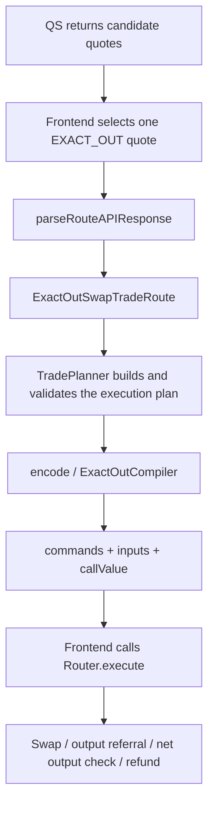

# SDK Exact-Out Implementation

This guide describes the current `feature/native-exact-out` implementation: how QS quotes become Universal Router commands, and how payments, output referral fees, and refunds work. It replaces the earlier overall design and referral design documents.

## 1. Goals and responsibilities

Exact-Out constrains a trade by its net output target and maximum input budget. The SDK encodes protocol-native Exact-Out commands; the pool or Router determines the actual input required on-chain. The SDK does not emulate Exact-Out with multiple Exact-In swaps or recalculate per-hop quotes.

- **QS** supplies candidate paths, estimated input, maximum input, net output, gross output, and the output referral fee rate.
- **Frontend** selects a quote, specifies the recipient and referral project, prepares approvals, and submits the transaction to a compatible Router.
- **SDK** parses and validates the quote, divides the route into sections, and generates swap, wrap, referral, output-check, and refund commands.
- **Router / pools / Permit2 / ReferralVault** execute swaps and payments, distribute output and refunds, and collect and account for referral fees.

The SDK does not query on-chain balances, allowances, pool state, or deployment versions. It does not sign or broadcast transactions. Successful encoding does not establish that a quote is executable.

Provided that historical Router balances do not interfere and token transfer behavior is compatible with the protocol, a successful transaction should deliver **at least the net target** without exceeding the swap input budget. Rounding or full-balance distribution can produce more output than the target; exact equality is not guaranteed. Network fees are not included in the swap budget.

## 2. Frontend flow



`parseRouteAPIResponse` accepts one `RouteData` entry, not the entire response or candidate array. Exact-Out requires an explicit `tradeType: 'EXACT_OUT'`; omitting it selects Exact-In.

```typescript
import {
  Address,
  TradePlanner,
  parseRouteAPIResponse,
  type ExactOutRouteData,
} from '@sun-protocol/universal-router-sdk'

function encodeExactOut(
  quote: ExactOutRouteData,
  isTestnet: boolean,
  recipient?: string,
  referralProject?: string,
) {
  const route = parseRouteAPIResponse(quote, isTestnet)
  if (recipient) route.recipient = new Address(recipient)

  if (route.outputReferralBips > 0 && !referralProject) {
    throw new Error('Output referral requires a project address')
  }

  const planner = new TradePlanner([route], false, {
    referralOptions: route.outputReferralBips > 0
      ? { mode: 'output', bps: route.outputReferralBips, projectAddress: referralProject! }
      : undefined,
  })
  planner.encode()
  return { route, commands: planner.commands, inputs: planner.inputs, callValue: planner.callValue }
}
```

Pass the result to the selected Router:

```typescript
// encoded is the result of encodeExactOut above; router is a TronWeb contract instance.
// deadline is the frontend-selected Unix timestamp in seconds.
if (encoded.callValue > BigInt(Number.MAX_SAFE_INTEGER)) {
  throw new Error('callValue exceeds the client safe integer range')
}
await router.execute(encoded.commands, encoded.inputs, deadline).send({
  callValue: Number(encoded.callValue),
})
```

Usage notes:

- `isTestnet` controls TRX/WTRX pair recognition. It does not select a Router or validate its deployment.
- Exact-Out supports `slippageBips` (preferred) or `slippage` overrides. Without either, it uses the QS maximum input. `slippageBips` is a bigint from 0 through 10000; the maximum input becomes `ceil(amountInRaw × (10000 + slippageBips) / 10000)`. The legacy `slippage` parameter is a fraction in [0, 1), rounded to millionths as in Exact-In before rounding the budget up. Zero sets the maximum input to the estimated input. Frontend display, approvals, and TRX callValue use the parsed budget; net and gross output stay unchanged.
- Only one route is accepted. Do not enable `tradeSpiltOptions.enable` or `oneShotTransfer`.
- Configure the route before creating the Planner. Create a fresh Planner and call `encode()` once per transaction; repeated calls append commands.
- Failed Exact-Out encoding restores `commands` and `inputs` to their state before that encoding attempt. This is not an on-chain rollback mechanism.
- Both output and refunds go to `recipient`, defaulting to `MSG_SENDER`. The transaction sender remains the payer.

## 3. Quote fields and internal amounts

See [routeAPI.ts](../src/types/routeAPI.ts) and [route.ts](../src/types/route.ts) for types. Raw amounts are decimal integer strings, parsed into `bigint` values in the token's smallest unit.

| QS field | Internal field | Purpose |
| --- | --- | --- |
| `amountInRaw` | `amountIn` | Estimated input, used for budget consistency, PSM precision checks, and the transfer amount for pure unwrapping; not the actual amount paid by a general swap |
| `amountInMaximumRaw` | `maximumAmountIn` | Default maximum input, overridden from estimated input when slippage is supplied; also `callValue` for TRX input |
| `amountOutRaw` | `amountOut` | Net output target after fees; the minimum balance for the final output SWEEP |
| `grossAmountOutRaw` | `grossAmountOut` | Gross output target passed to the protocol swap command |
| `amountOutReferralBips` | `outputReferralBips` | Output fee rate, defaulting to zero |
| `amountInReferralBips` | Not retained | Used only to reject nonzero input fee rates |

`ExactOutSwapTradeRoute` has neither `minimumAmountOut` nor a nested `exactOut` amount object. Read `route.amountOut` to display the minimum amount received.

Formatted strings such as `amountIn`, `amountOut`, and `amountInMaximum`, along with the common `stepAmountsOut` field, remain part of the QS types but do not determine Exact-Out amount encoding. The SDK does not read `stepAmountsInRaw`, `stepAmountsOutRaw`, per-hop execution modes, `amountInRawReferral`, or `amountOutRawReferral`.

For budget validation, let the estimated input be `Q = amountIn` and the maximum input be `M = maximumAmountIn`:

```text
M >= Q > 0
```

For gross output consistency, let the net target be `N = amountOut`, the gross target be `G = grossAmountOut`, the output fee rate be `b = outputReferralBips`, and the denominator be `D = 10000`:

```text
0 <= b < D, with integer b
G - floor(G × b / D) >= N > 0
```

This relationship checks whether the quote covers the net target. The SDK does not require the smallest possible gross target, nor does it pass the calculated fee to the contract as a fixed amount.

## 4. Path parsing and validation

Quote parsing is implemented in [parseRouteAPIResponse.ts](../src/core/parseRouteAPIResponse.ts), and route validation in [exactOut.ts](../src/core/exactOut.ts). Manually constructed routes are also validated when building an execution plan.

A quote must satisfy these conditions:

- At least one hop, with `tokens.length = poolVersions.length + 1`.
- `poolKeys.length = poolVersions.length`; non-V4 hops may use `null`.
- `poolFees` supplies at least one fee per hop. Extra display entries do not affect encoding.
- Supported version strings are `v1`, `v2`, `v3`, `v4`, `usdt20psm`, and `wtrx`.
- The current network's TRX/WTRX pair is recognized as wrapping first, even when labelled `v2`, `v3`, or `v4`. This does not allow arbitrary unknown version strings.
- Addresses may use Base58Check, 20-byte `0x` format, or TRON hex with a `41` prefix. Exact-Out validates formatting and Base58 checksums.
- V4 PoolKey token0/token1 must match the sorted token pair for that hop. Encoding uses the PoolKey's fee, hooks, and parameters.

Execution requires connected pools, correctly ordered token pairs, and a final currency matching the route output. Repeated pools are rejected. Pool identity uses the protocol and token pair, plus the fee for V3, and the fee, hooks, and parameters for V4; validation does not query actual pool addresses.

| Route | Validation and encoding |
| --- | --- |
| V1 | TRX→Token, Token→TRX, Token→Token; an explicit Token→TRX→Token path is accepted, but only the endpoints are encoded |
| V2 / V3 | One protocol with a single hop or multiple distinct pools; native TRX requires WTRX conversion |
| V4 | One protocol with one or more hops; native TRX is supported directly |
| PSM | One hop using `PoolFlag.PSM`, subject to the fixed precision checks below |
| Pure wrapping | One TRX→WTRX or WTRX→TRX hop |
| Wrapping plus swapping | Entry TRX→WTRX and exit WTRX→TRX are allowed; intermediate wrapping is rejected |
| Mixed protocols, splits, Stable, HTX Sun | Rejected for Exact-Out |

An explicit V1 intermediate currency must be TRX, with at most two V1 pools. The contract performs the internal TRX bridge for an endpoint-only Token→Token path. SDK support still requires a Router deployment with the corresponding commands.

The output recipient marker cannot be the zero address or `ADDRESS_THIS`. This check does not query the actual Router address; the frontend should supply an external recipient address.

### Amount widths

Amounts must fit command encoding limits. The net target and ERC20 maximum input must fit `uint160`; the native maximum input generally must fit `uint256`. V3 gross output must fit the positive range of `int256`. V4 gross output must fit the positive range of `int128`, and its maximum input must fit `uint128`. Other base amounts use the `uint256` range.

### PSM precision constraints

Let the estimated input be `Q = amountIn`, gross output be `G = grossAmountOut`, and the fixed precision ratio be `R = 10^12`. The current implementation accepts either relationship:

```text
G = Q × R
or
Q % R = 0 and G = Q / R
```

Validation does not hardcode USDD, USDT, or PSM contract addresses. The command carries a flag, and the Router's registered configuration selects the pool. These relationships do not validate the actual deployment, direction, or current fee on-chain. Even if the contract can round up a non-divisible target, the SDK rejects quotes that do not satisfy this relationship.

## 5. Command compilation and protocol differences

[buildExecutionFromRoute.ts](../src/core/buildExecutionFromRoute.ts) groups adjacent pools of the same protocol into sections. [TradePlanner.ts](../src/core/TradePlanner.ts) dispatches by trade type; [compileExactOut.ts](../src/core/compileExactOut.ts) handles Exact-Out commands. Exact-In retains its own compiler.

The overall sequence is:

```text
Optional PERMIT2_PERMIT
→ PERMIT2_TRANSFER_FROM for pure unwrapping
→ Wrapping / protocol swaps / unwrapping by section
→ Optional PAY_REFERRAL in the final output currency
→ SWEEP(output currency, recipient, net target)
→ Remaining WTRX unwrapping and input refunds where applicable
```

The SDK adds these payment and cleanup commands; QS does not provide a command list. `commands` contains command bytes and `inputs` contains their ABI parameters. A single `Router.execute(bytes,bytes[],uint256)` executes them.

In the table below, `G` is `grossAmountOut`, `M` is `maximumAmountIn`, and `THIS` is `ADDRESS_THIS`:

| Protocol | Swap command and path |
| --- | --- |
| V1 | `V1_SWAP_EXACT_OUT(THIS, G, M, [input, output], payerIsUser)`; the contract performs the TRX bridge |
| V2 | `V2_SWAP_EXACT_OUT(THIS, G, M, forwardAddressPath, payerIsUser)` |
| V3 | `V3_SWAP_EXACT_OUT(THIS, G, M, reversedBytesPath, payerIsUser)`; tokens and fees are reversed together |
| PSM | `PSM_SWAP_EXACT_OUT(THIS, G, M, forwardAddressPath, flags, payerIsUser)` |
| V4 | An outer `V4_SWAP` containing Exact-Out swap, settle, and take actions |

`payerIsUser` is true only when the swap section is the first section and its input is not native currency. When there is an entry wrap, the Router pays for the swap.

### V4 paths and settlement

Single-hop swaps use `CL_SWAP_EXACT_OUT_SINGLE`, containing the PoolKey, direction, gross target, and maximum input. Multi-hop swaps use `CL_SWAP_EXACT_OUT`: `currencyOut` is the final output, and the path is built in forward pool order. Each `intermediateCurrency` is that hop's forward input currency; the compatible Router traverses the path in reverse.

After the swap, the payer determines the settlement action. Here, `M` is `maximumAmountIn`, and `OPEN_DELTA` means reading the current unsettled delta:

| Payment mode | Action | Meaning |
| --- | --- | --- |
| User pays ERC20 | `SETTLE_ALL(input, M)` | Settle the actual debt in the input currency, capped at M |
| Router pays, such as native TRX input | `SETTLE(input, OPEN_DELTA, false)` | Settle actual debt from Router funds, without pulling M again; swap parameters also enforce the maximum input |
| Collect output | `TAKE(output, THIS, OPEN_DELTA)` | Send available output to the Router for outer referral and SWEEP distribution |

Exact-Out always uses empty `hookData` (`0x`); custom hook data is not supported. Exact-In currently uses 20 zero bytes, which hooks may treat differently. Dynamic-fee PoolKeys can be encoded, but that does not establish that arbitrary hooks or dynamic-fee deployments have been validated.

## 6. Approvals, actual payments, and refunds

### ERC20 input

The frontend must approve Permit2 on the input token and grant the target Router a Permit2 allowance. Alternatively, a valid Permit2 signature lets the SDK prepend `PERMIT2_PERMIT`. The signature does not replace the token's approval of Permit2.

Balances and allowances covering `maximumAmountIn` cover the full budget, but the full budget is not necessarily spent:

- Standard user-paid V2/V3/PSM paths pull the actual required input. The SDK does not pre-transfer an extra slippage allowance.
- V4 settles the actual debt after the swap.
- A compatible V1 Router handles the required input transfer and internal swaps. The SDK appends an input-token `SWEEP(..., 0)` after output distribution to refund any remaining input.
- Pure WTRX→TRX first transfers `amountIn` to the Router, then unwraps the Router's WTRX balance. It does not pre-transfer the full maximum budget.

Exact-Out's `permitEnabled` does not control these payment choices. The implementation uses the optional permit signature and the section's position in the payment flow.

### Native TRX input

`planner.callValue = maximumAmountIn`, in SUN; it is zero for ERC20 input. This getter also returns zero for legacy Exact-In, so it must not replace the existing Exact-In payment logic.

| Path | Prefunding and refunds |
| --- | --- |
| TRX→WTRX→V2/V3, etc. | Wrap the maximum budget, spend the required WTRX, then unwrap remaining WTRX after output distribution and SWEEP TRX to the recipient |
| Native TRX→V1/V4 | Use the Router's TRX directly, then SWEEP remaining TRX to the recipient |
| Pure TRX→WTRX | Receive the maximum budget but wrap only `grossAmountOut`; distribute WTRX and refund remaining TRX |

Pure wrapping amounts come from QS. Current validation does not independently enforce `amountIn = grossAmountOut` for pure wrapping, so successful parsing does not establish a fully validated 1:1 quote. Insufficient funding and similar issues may fail only during execution.

## 7. Output referral fees

Exact-Out supports no referral fee or output referral fees only. Nonzero `amountInReferralBips` is rejected, as is `referralOptions.mode = 'input'`, even at a zero fee rate. QS raw referral amount fields do not affect SDK encoding or validation.

When the quote has a positive output fee rate, the frontend must supply `mode: 'output'`, matching `bps`, and a project address. A zero-fee quote cannot be combined with a nonzero fee option. The project address is the Vault's referral accounting address, separate from the swap `recipient`.

After swaps and any exit unwrapping, the SDK appends:

```text
PAY_REFERRAL(outputToken, projectAddress, bps)
SWEEP(outputToken, recipient, amountOut)
```

Let the Router's output-token balance at fee collection be `B`, the output fee rate be `b`, the denominator be `D = 10000`, and the fee collected on-chain be `F`:

```text
F = floor(B × b / D)
The user receives the remaining output balance at SWEEP time.
```

`B` is the execution-time balance, not a fixed QS fee amount, and need not equal the quoted gross output. `PAY_REFERRAL` checks the Vault's fee limit, updates the balance snapshot, transfers the fee, and invokes referral accounting. The Vault then splits the fee between the project and protocol using its default or project-specific share. The SDK output fee rate and the Vault's allocation ratio are separate parameters.

For example, in output-token base units, a net target of 100000, actual gross output balance of 101010, and fee rate of 100 bips (1%) give:

```text
Fee = floor(101010 × 100 / 10000) = 1010
Remaining output = 100000; the SWEEP minimum is also 100000.
With an 80% Vault project share, the project is credited 808 and the protocol 202.
```

The Router must have a usable ReferralVault, and the Vault must authorize that Router. Fee limits and project allowlists are on-chain configuration; the SDK neither queries nor changes them.

## 8. SWEEP, same-currency loops, and balance limitations

In `SWEEP(token, recipient, minimum)`, `minimum` is a balance floor, not a fixed transfer amount. Insufficient balance causes failure; otherwise, the full available token balance is sent. Output checks and input refunds therefore serve different purposes:

- Output SWEEP uses the net target `amountOut` as its minimum.
- Input refund SWEEP uses zero, allowing no refund.

The SDK preserves the Router's full-balance semantics and does not isolate historical balances. External transfers or leftover funds may satisfy an output check, enter the referral fee base, or be swept along with the trade. Output fees can be interpreted as fees on this transaction's output only when historical balances do not interfere.

A transaction's refund must not count as output. For example, prefunding 120 A, spending 105 A, and receiving 100 A leaves 115 A in the Router, including a 15 A refund. Charging an output fee on all 115 A would also charge the refund. This illustrates the risk; current validation rejects the prepaid overlaps it identifies.

Native-input and V1 routes are treated as prepaid paths. Validation rejects relevant same-currency overlaps between swap input/output, route input/output, and swap input/final output. V4 net-delta loops with identical swap input and output are also rejected. User-paid V2/V3 same-currency routes may pass validation when they use distinct pools and satisfy the other checks.

## 9. Source map and validation

| File | Responsibility |
| --- | --- |
| [routeAPI.ts](../src/types/routeAPI.ts) | QS Exact-In / Exact-Out union types |
| [route.ts](../src/types/route.ts) | Routes, execution plans, and options |
| [parseRouteAPIResponse.ts](../src/core/parseRouteAPIResponse.ts) | Quote parsing, amount mapping, and network-specific wrapping recognition |
| [exactOut.ts](../src/core/exactOut.ts) | Amount, address, protocol, precision, and settlement validation |
| [buildExecutionFromRoute.ts](../src/core/buildExecutionFromRoute.ts) | Connected paths and protocol sections |
| [TradePlanner.ts](../src/core/TradePlanner.ts) | Trade-type dispatch, callValue, and recovery after encoding errors |
| [compileExactOut.ts](../src/core/compileExactOut.ts) | Exact-Out swaps, referrals, output distribution, and refunds |
| [encodePath.ts](../src/core/encodePath.ts) | Protocol-specific path formats |
| [createCommand.ts](../src/core/createCommand.ts) | Router command parameter ABIs |
| [ActionsPlanner.ts](../src/packages/v4/entities/ActionsPlanner.ts) | V4 action encoding |

Local validation:

```sh
npm test
npm run build
# After preparing compatible contract sources, dependencies, Foundry, and solc:
ROUTER_SOURCE=/path/to/sunswap-universal-router npm run test:contracts
```

SDK tests cover validation, command and payment ordering, reversed V3 paths, V4 paths and settlement, referrals, refunds, recovery after encoding errors, and Exact-In encoding baselines. See [exactOut.test.ts](../src/core/exactOut.test.ts).

Contract execution tests send SDK-encoded calldata through the actual Router and Permit2. V1/V2/V3/PSM use controlled pools or exchanges; V4 uses a local actual PoolManager and liquidity fixtures. The controlled V2 pools do not fully simulate production invariants or reserve updates. Encoding coverage for dynamic fees does not replace execution evidence for actual dynamic fees or hooks. See [tests/contracts/README.md](../tests/contracts/README.md).

The Nile integration harness remains local and is not published with the repository. Tests using constructed QS-shaped quotes validate that SDK→Router path, not real QS quote generation. Deployment addresses, Vault configuration, and transaction results are environment-specific records, not general SDK support guarantees.

For a runnable encoding example, see [examples/exact-out/encode.cjs](../examples/exact-out/encode.cjs). Its input file contains a single quote, and the example parses wrapping addresses for mainnet by default.
